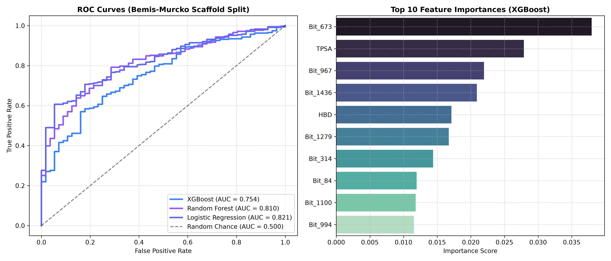

# 🧠 Blood-Brain Barrier (BBB) Penetration Prediction

An end-to-end Chemoinformatics and Machine Learning web application to predict whether small drug molecules can permeate the human Blood-Brain Barrier (BBB) based on SMILES strings.



---

## 📌 Overview

The **Blood-Brain Barrier (BBB)** is a physiological barrier that protects the central nervous system (CNS) by selectively preventing harmful substances from entering brain tissue. In neurotherapeutics drug discovery, understanding whether a candidate molecule can permeate the BBB is a crucial early-stage screening criterion.

This project implements:
1. **Chemoinformatics Feature Engineering**: Extracts 5 key Lipinski physicochemical properties (Molecular Weight, LogP, TPSA, H-Bond Donors, H-Bond Acceptors) along with **2048-bit Morgan Fingerprints (radius 2 / ECFP4)** using RDKit.
2. **Scaffold-Based Validation**: Evaluates models using **Bemis-Murcko Scaffold Splitting**, preventing structural data leakage and ensuring realistic generalizability to novel molecular scaffolds.
3. **Machine Learning Models**: Benchmarks Logistic Regression, Random Forest, and **XGBoost Classifier** with ROC-AUC evaluation.
4. **Interactive Web Dashboard**: A single-page web UI featuring 2D chemical structure rendering, penetration probability gauge, Lipinski rule-of-five compliance checker, and preset drug molecules (Diazepam, Caffeine, Dopamine, Penicillin V).

---

## 🚀 Features

- **SMILES Parsing & Validation**: Real-time molecular structure verification using RDKit.
- **Explainable Predictions**: Displays physicochemical properties alongside predicted permeability probabilities.
- **Pre-trained Model**: Uses a serialized XGBoost model (`bbbp_model.pkl`) trained on the MoleculeNet BBBP benchmark dataset.
- **RESTful API**: Flask backend providing a `/predict` JSON endpoint.

---

## 🛠️ Project Structure

```text
├── app.py                      # Flask REST API & Web Server
├── index.html                  # Interactive frontend dashboard
├── pipeline.py                 # Data preprocessing, scaffold split & model training
├── bbbp_model.pkl              # Pre-trained XGBoost classification model
├── bbbp_model_performance.png  # ROC-AUC comparison curves
├── requirements.txt            # Python dependencies
├── .gitignore                  # Git ignore rules
└── data/
    └── BBBP.csv                # MoleculeNet Blood-Brain Barrier dataset
```

---

## ⚡ Getting Started

### 1. Clone the Repository
```bash
git clone https://github.com/<YOUR_USERNAME>/<YOUR_REPOSITORY>.git
cd "Blood Brain Barrier prediction"
```

### 2. Create and Activate a Virtual Environment
```bash
# Windows
python -m venv venv
venv\Scripts\activate

# macOS / Linux
python3 -m venv venv
source venv/bin/activate
```

### 3. Install Dependencies
```bash
pip install -r requirements.txt
```

### 4. Run the Application
```bash
python app.py
```
Open your browser and navigate to:
```text
http://127.0.0.1:5000
```

---

## 🧪 Retraining the Model

To run the pipeline and retrain the models:
```bash
python pipeline.py
```
This will:
1. Load `data/BBBP.csv`.
2. Extract Morgan fingerprints and physicochemical descriptors.
3. Apply Bemis-Murcko scaffold splitting.
4. Train and evaluate Logistic Regression, Random Forest, and XGBoost.
5. Export `bbbp_model.pkl` and `bbbp_model_performance.png`.

---

## 📊 Dataset Reference
- **Dataset**: MoleculeNet Blood-Brain Barrier Penetration (BBBP) Dataset
- **Reference**: Martins, Ines Filipa, et al. *"A Bayesian approach to in silico blood-brain barrier penetration modeling."* Journal of chemical information and modeling 52.6 (2012): 1686-1697.

---

## 📄 License
This project is open source and available under the [MIT License](LICENSE).
